# EcoBite 🌿

**Plataforma de delivery con enfoque sostenible**

---

## Acerca del Proyecto

EcoBite es una startup de **FoodTech** que busca revolucionar la industria del delivery mediante soluciones tecnológicas innovadoras. La plataforma está diseñada para ofrecer una experiencia de usuario optimizada, combinando eficiencia operativa con prácticas sostenibles.

---

## Objetivo

Desarrollar una plataforma de delivery que permita:

- Gestión de pedidos y seguimiento en tiempo real
- Interfaz intuitiva para clientes y repartidores
- Sistema de notificaciones eficiente
- Arquitectura escalable y mantenible

---

## Tecnologías

- **Frontend:** React, TypeScript, Vite, Tailwind CSS y React Router DOM, Docker Compose y pgAdmin para el entorno local de base de datos.
.
- **Backend:** Node.js, Express y PostgreSQL (`pg`).
## Aplicación en producción

- **Sitio web:** [s2603-eco-bite.vercel.app](https://s2603-eco-bite.vercel.app/)
- **API:** [ecobite-backend-1ldk.onrender.com](https://ecobite-backend-1ldk.onrender.com/)

## Diseño y mockups

Diseños, prototipos y pantallas del proyecto:

| Mockups | | |
| --- | --- | --- |
| Primer prototipo 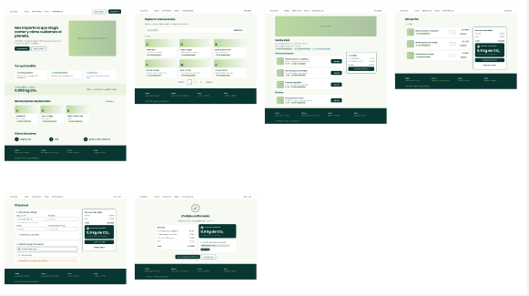 | Flujo de compra 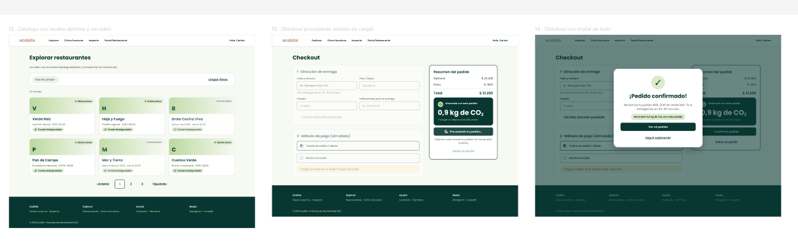 | Wireframes del análisis de datos 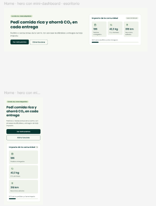 |
| Página de inicio final 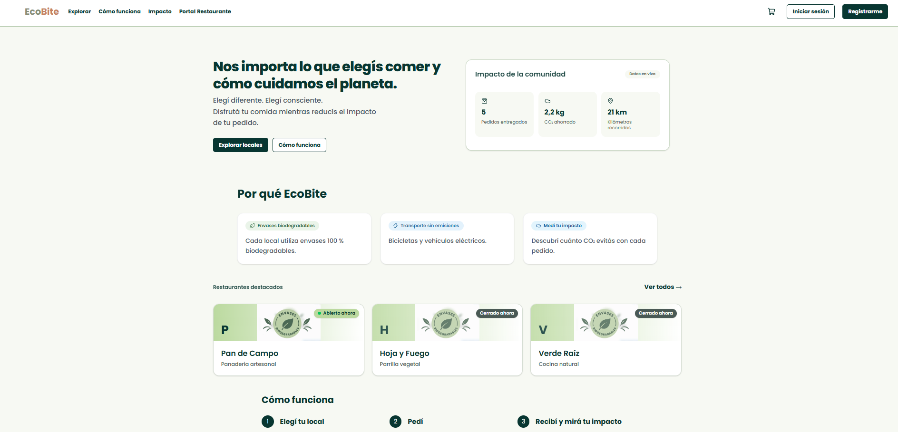 | Inicio de sesión 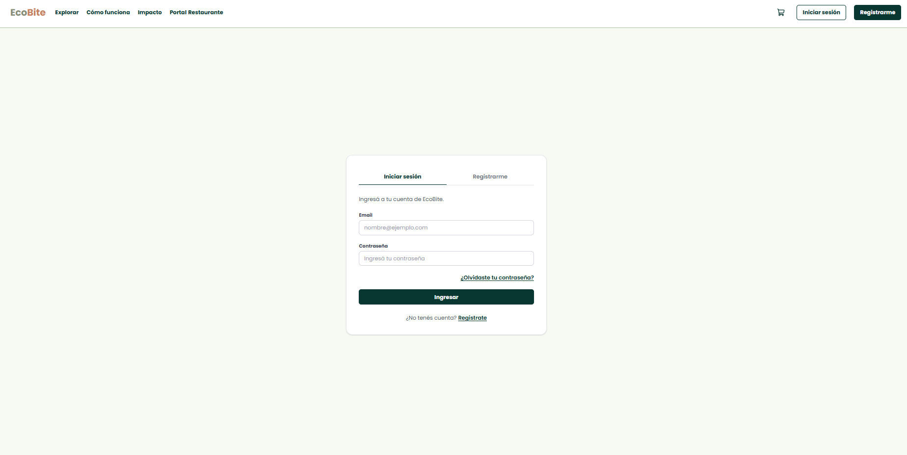 | Registro de cliente y restaurante 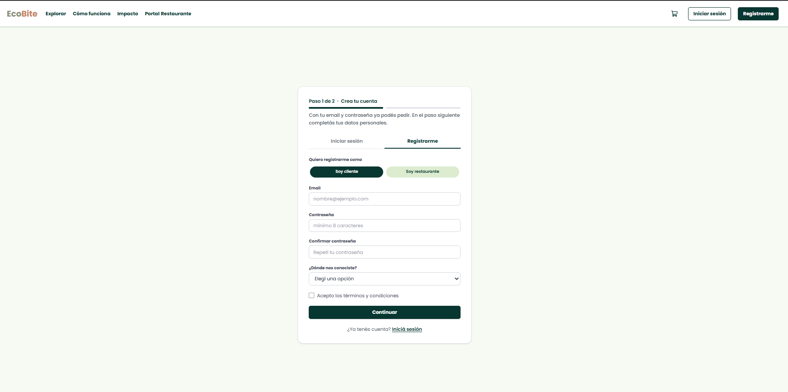 |
| Registro de cliente, paso 2 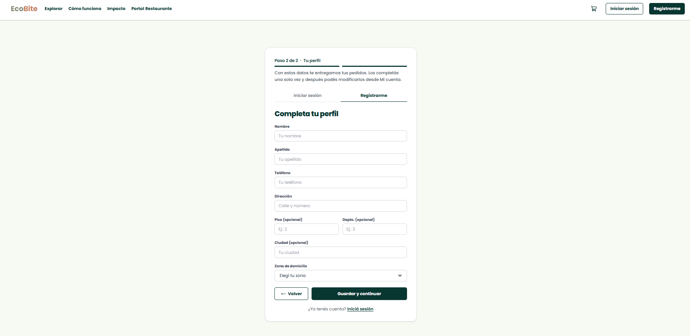 | Registro de restaurante, paso 2 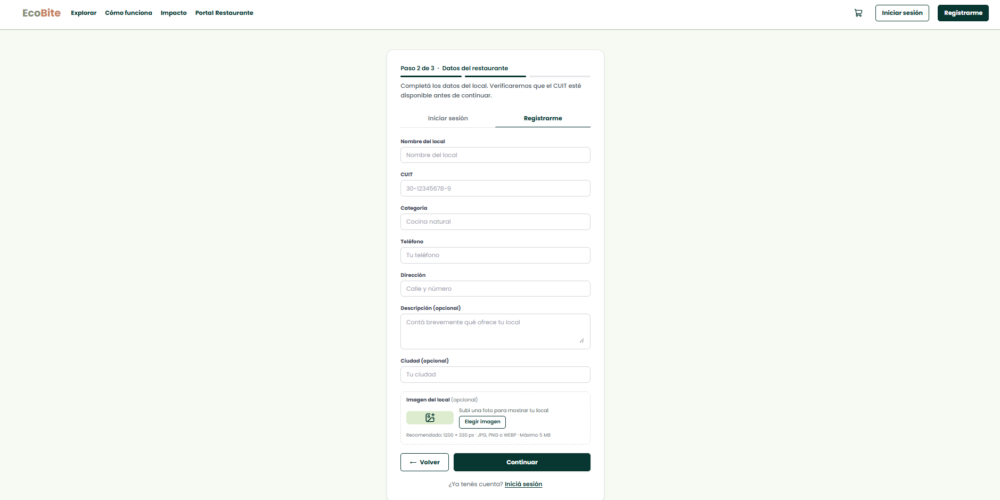 | Registro de restaurante, paso 3 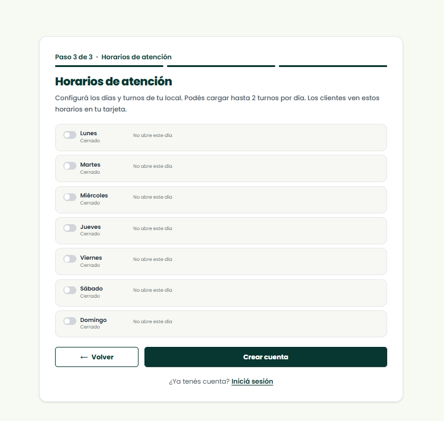 |
| Diseño responsive 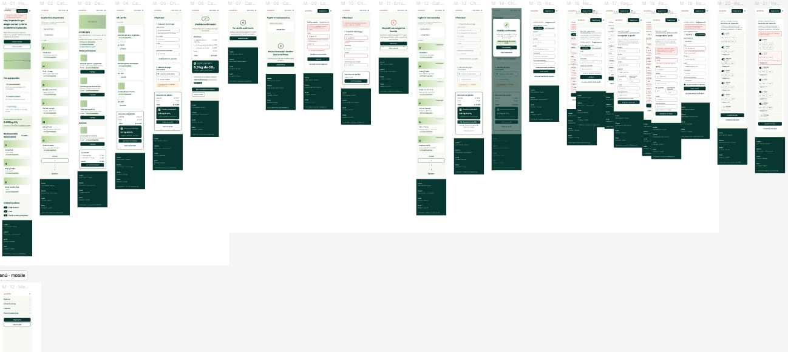 | Dashboard 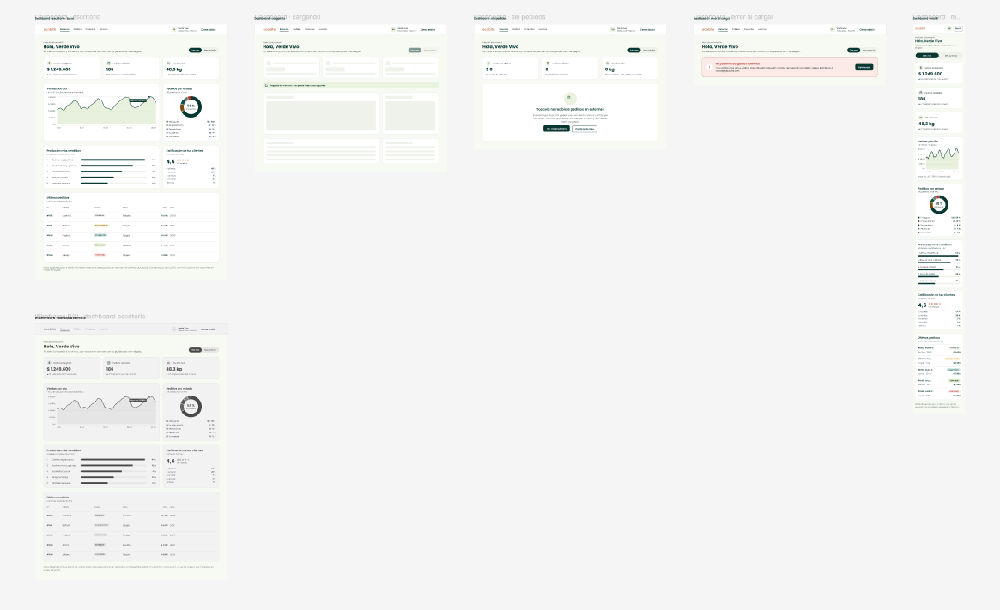 | Dashboard final 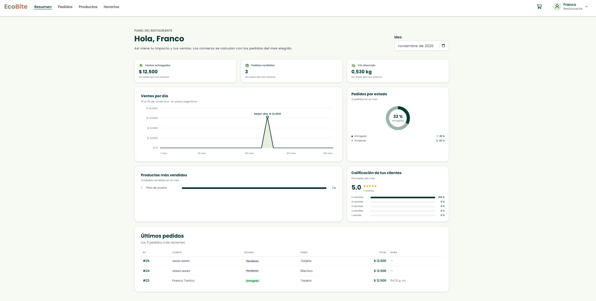 |

---

## Estructura del Proyecto

*[Sección a completar con la estructura de directorios y archivos relevantes]*

---

## Plan de Testing

La documentación de testing del proyecto está centralizada en Google Drive:

**[Acceder a la carpeta de Testing — EcoBite](https://drive.google.com/drive/folders/1u0dHy75aMJyqiXqOvlvtUyAHdIVAhIp7?usp=sharing)**

| Documento | Descripción |
|-----------|-------------|
| **Plan de Testing** | Alcance, estrategia, tipos de prueba, recursos, cronograma y criterios de entrada/salida. |
| **Casos de Prueba** | Pasos, datos de prueba y resultados esperados para cada funcionalidad. |
| **Reportes de Bugs** | Incidentes detectados durante la ejecución y su seguimiento. |

---

## Miembros del Equipo

| Rol | Nombre | LinkedIn |
|-----|--------|----------|
| Tester | Erika Helfenstern | https://www.linkedin.com/in/hevieri/ |
| Tester | Mayra Chazarreta | https://www.linkedin.com/in/mayra-chazarreta-33a3b9406?utm_source=share_via&utm_content=profile&utm_medium=member_android |
| Frontend | Franco Alex Torrico | https://www.linkedin.com/in/francotorrico/ | 
| Diseñador Gráfico | Maria Pilar Donovan | |
| Diseñador UX/UI | Carina Alejandra Luna | https://www.linkedin.com/in/carina-alejandra-luna |
| Marketing | Jorgelina Riquelme | https://ar.linkedin.com/in/jorgelina-riquelmee- |
| Data Analyst | Fernando Romero | |
| Project Manager | Jeanette Ruiz Valiente | https://www.linkedin.com/in/jeanette-elizabeth-ruiz-valiente-a4b480370?utm_source=share_via&utm_content=profile&utm_medium=member_android |
|Backend |Sabrina Tolay | https://www.linkedin.com/in/sabrinatolay/|
| | | |
| | | |

---

*EcoBite - FoodTech | 2026*
